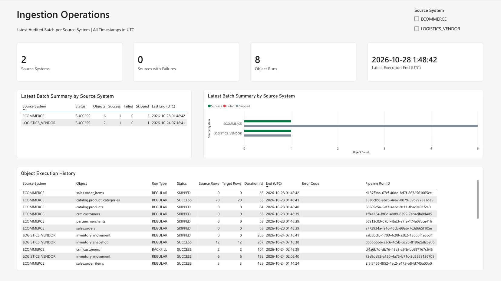

<h1 align="center">Metadata-Driven Ingestion Pipelines in Microsoft Fabric</h1>

<p align="center">
  <strong>Configure ingestion for many source objects without building a separate pipeline for each one.</strong>
</p>

<p align="center">
  
  
  
</p>

<p align="center">
  <a href="#architecture">Architecture</a> ·
  <a href="#design-highlights">Design highlights</a> ·
  <a href="#how-the-framework-works">How it works</a> ·
  <a href="#start-here">Start here</a> ·
  <a href="#run-the-example">Run the example</a>
</p>

Building a separate pipeline for each table or file feed is a practical starting point in Microsoft Fabric. As more sources are added, repeating the same ingestion logic across pipelines becomes harder to maintain.

This repository implements **metadata-driven ingestion pipelines in Microsoft Fabric**. Instead of maintaining
separate pipelines for individual source objects, the framework uses configuration tables to define what to ingest,
how to process it, and where to write the results. Reusable orchestration routes each object through the appropriate
ingestion path, with consistent watermark management and run auditing.

The repository demonstrates end-to-end **batch ingestion** from SQL Server tables and CSV files delivered over SFTP.
Both paths support `FULL` and `INCREMENTAL` loads into **Bronze Delta tables in a Fabric Lakehouse**.
Successful loads append new Bronze batches, while incremental processing uses watermarks to track progress where applicable.

## Architecture

The diagram summarizes the framework's logical responsibilities and two ingestion paths.

[](docs/assets/architecture-overview.svg)

Fabric SQL Database stores source configurations, logical source/target connection references, committed
watermarks, and completed object-run audit records. Each **source object** represents a SQL Server table or a
logical SFTP file feed that may match multiple physical files. Fabric Data Pipelines use this metadata to
route ingestion and coordinate loading into Bronze Delta tables.

See [Architecture & Design Decisions](docs/architecture/framework-overview.md) for the pipeline structure and design trade-offs.

## Design highlights

- **Reusable, metadata-driven orchestration.** Configure source objects, connections, load strategies, and Bronze targets without building a separate pipeline for each dataset.
- **Safe incremental checkpoints.** Only eligible successful REGULAR incremental runs advance watermarks; BACKFILL and no-new-data SKIPPED leave them unchanged.
- **Scoped failure recovery.** Failed Bronze writes trigger execution-scoped cleanup. If incremental success finalization fails, the framework checks the committed SQL audit outcome before deciding whether cleanup is safe. An activity error does not necessarily mean the SQL transaction failed.
- **Operational monitoring.** Fabric Monitor shows pipeline execution; SQL audit tables store object-run outcomes, and a Power BI report presents them in a clear operational view.

[](docs/assets/screenshots/core/c15-operations-report.png)

*The Power BI Operations Report brings ingestion status and execution history into one view. In this example, both source systems show successful latest batch summaries, with no failed sources.*

## How the framework works

| Stage | What happens |
| --- | --- |
| **Configure** | Define source details, connection references, load strategies, and Bronze targets through shared metadata. |
| **Select and route** | Gather active configurations (optionally filtered by source system) or use an explicit request list. Validate and route each object to the right ingestion path. |
| **Load into Bronze** | Copy SQL Server table data directly into Bronze Delta tables. For SFTP, land the raw files first, then parse and append their records to Bronze Delta tables. |
| **Finalize and inspect** | Save each object's final status and row counts in SQL audit tables, and update eligible incremental checkpoints. Review pipeline execution in Fabric Monitor and audit summaries in Power BI. |

## Start here

You do **not** need a Fabric workspace to explore the architecture and code. Choose a route rather than reading every document in order:

| Your goal | Recommended entry |
| --- | --- |
| **Understand the architecture** | [Architecture & Design Decisions](docs/architecture/framework-overview.md) — orchestration, state, and trade-offs |
| **Understand how it works in code** | [Technical Learning Path](docs/guides/learning-path.md) — guided SQL Server/SFTP walkthroughs, then detailed technical guides |
| **Set up the demo environment** | [Environment Rebuild](docs/operations/environment-rebuild.md) — new-workspace checklist, with the [SQL run order](scripts/RUN_ORDER.md) |

*For a new workspace, rebind environment-specific references in the Fabric item definitions as described in [Environment Rebuild](docs/operations/environment-rebuild.md).*

**Repository layout:** `fabric/` tracks Fabric Data Pipelines, Notebooks, SQL Database, Lakehouse, Variable Library,
and Power BI definitions; `scripts/` contains SQL setup and demo fixtures; `infra/` provides optional EC2/Docker
Compose setup for the demo SQL Server and SFTP sources.

## Run the example

To reproduce the examples, follow the [workspace setup guide](docs/operations/environment-rebuild.md) and
[SQL and sample-data setup sequence](scripts/RUN_ORDER.md). These instructions are intended for a new, empty DEV
workspace and should not be used to overwrite an existing environment.

Once the sources and Fabric items are configured, run `pl_ingest_orchestrator`. For example, to select the active SFTP source objects:

```text
p_run_requests = []
p_source_system = "LOGISTICS_VENDOR"
```

`REGULAR` and `BACKFILL` describe execution intent; `FULL` and `INCREMENTAL` are configured load strategies.
See [Run Request Examples](docs/operations/run-request-examples.md) for explicit requests and historical windows.

The orchestrator selects matching objects and invokes the required child pipelines. After the run, inspect its
activities in **Fabric Monitor**, then check `audit.ingestion_log` and the **Power BI Operations Report** for
recorded results. The [SFTP walkthrough](docs/guides/sftp-file-ingestion.md) shows how to compare Landing, Bronze,
and watermark state.

To set up the optional SQL Server and SFTP demo environment, see the
[EC2/Docker Compose setup](infra/source/README.md). This environment is not required to explore the repository;
review its configuration and security notes before deploying it.

## License

No license is currently included. Public access does not by itself grant reuse or redistribution rights.
