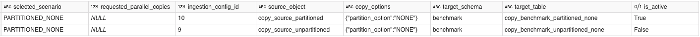
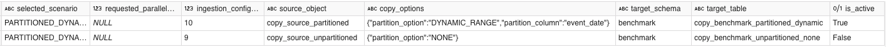
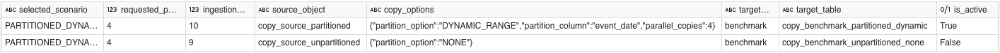
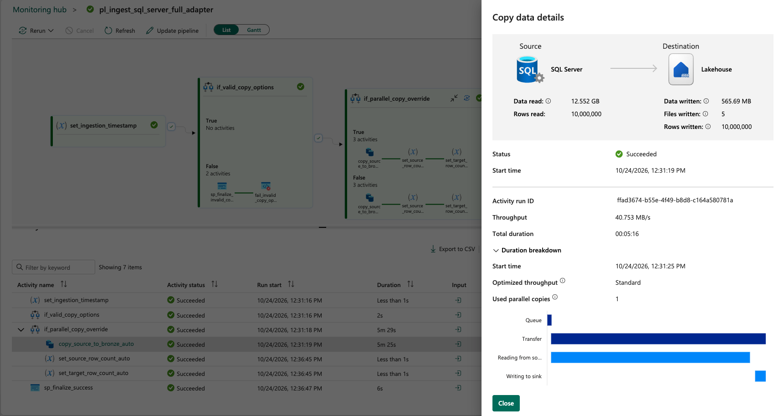
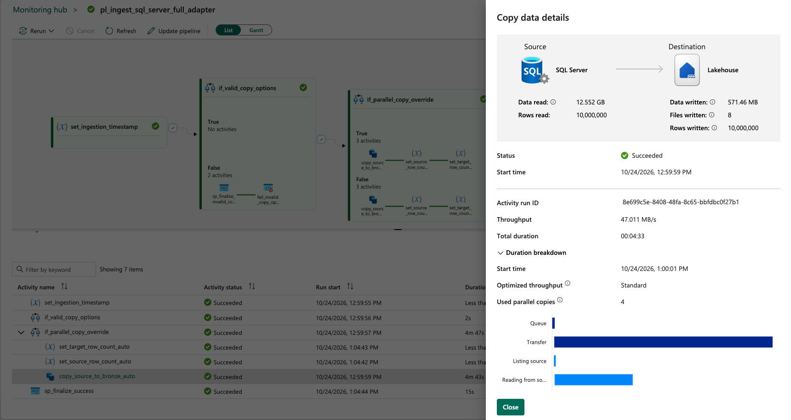
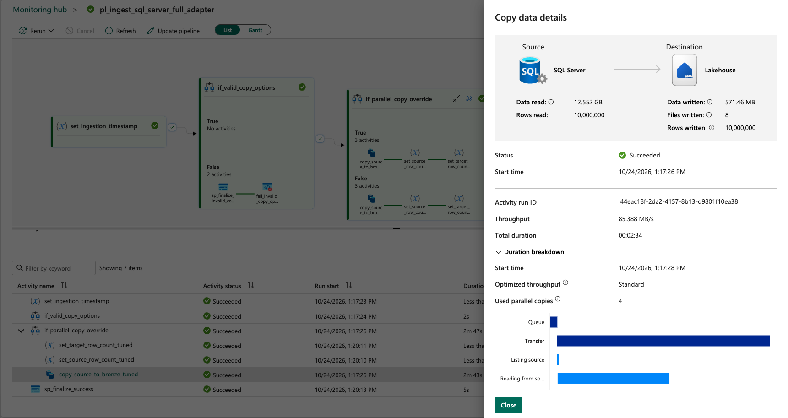

# Database Copy Performance Strategy

This document records the SQL Server Copy settings and measured DEV observations behind the current framework.
The [SQL Server ingestion guide](../guides/sql-server-database-ingestion.md) follows the corresponding execution path.
Observed DEV results are distinguished from planned comparisons below.

## Implemented scope

The current SQL Server 2022 Developer on EC2 adapter uses Copy activities in Fabric Data Pipelines to ingest data into Bronze.

The framework keeps orchestration in Fabric Data Pipelines and uses
connector-native parallel partitioning rather than moving simple relational
extraction into Spark. Spark remains appropriate when the workload is a
distributed transformation rather than connector-native data movement.

Official references:

- https://learn.microsoft.com/en-us/fabric/data-factory/connector-sql-server-copy-activity
- https://learn.microsoft.com/en-us/azure/data-factory/copy-activity-performance-features

## Metadata model

`control.ingestion_config.copy_options` is optional JSON execution metadata.

It is intentionally separate from `source_options`:

```text
source_options
= how source data/file content is read or parsed

copy_options
= how connector-native data movement is executed/tuned
```

Keeping copy execution hints in one JSON column avoids adding many nullable,
connector-specific columns to the shared ingestion configuration table.

### Current SQL Server 2022 Developer on EC2 contract

Default:

```sql
copy_options = NULL
```

means:

```text
partition_option = NONE
parallel_copies  = service-managed AUTO
```

Dynamic range example:

```json
{
  "partition_option": "DYNAMIC_RANGE",
  "partition_column": "order_item_id"
}
```

Optional explicit override (illustrative, not a benchmark-derived recommendation):

```json
{
  "partition_option": "DYNAMIC_RANGE",
  "partition_column": "order_item_id",
  "parallel_copies": 8
}
```

The value `8` illustrates the configuration syntax, not a benchmark-derived recommendation. The DEV observations
and remaining performance comparisons are described below.

Current SQL Server 2022 Developer on EC2 support (FULL and INCREMENTAL):

```text
partition_option = NONE | DYNAMIC_RANGE
```

All SQL Server ingestion uses **query-mode Copy**. `_ingestion_timestamp` is
CAST to `DATETIME2(3)` in the source query, so newly created Bronze Delta
tables receive a timestamp technical column rather than a String. Physical
source table layout is independent of this connector execution strategy.

`DYNAMIC_RANGE` requires an explicit `partition_column`. The current adapter
does not silently auto-select a PK/index because an explicit column makes the
per-object execution policy reviewable and deterministic.

`parallel_copies` is optional. Do not populate it from row count alone. Omitted
means Fabric chooses the parallel-copy degree. A positive integer is an explicit
operator override and should be retained only after representative performance
testing shows a measurable benefit or a source-load constraint requires it.

Internally the pipeline normalizes an omitted `parallel_copies` to parameter
value `0` only as a routing sentinel. The value `0` is never passed to the
Copy activity. The AUTO branch omits the `parallelCopies` property completely.

## Runtime flow

The SQL Server 2022 Developer on EC2 ingestion path converts Copy metadata into these execution parameters:

```text
p_copy_partition_option
p_copy_partition_column
p_copy_parallel_copies
```

The pipeline validates the supported combination before moving data.

Execution then selects one of two **query** Copy branches:

```text
p_copy_parallel_copies = 0
  -> copy_source_to_bronze_auto
     (parallelCopies omitted)

p_copy_parallel_copies > 0
  -> copy_source_to_bronze_tuned
     (parallelCopies = configured override)
```

Both modes use the same partition strategy.

For `NONE`:

```text
partitionOption = None
```

For `DYNAMIC_RANGE`:

```text
partitionOption = DynamicRange
partitionColumnName = configured partition_column
```

The query contains Fabric's required range placeholder:

```sql
?DfDynamicRangePartitionCondition
```

### FULL query shape

```sql
SELECT
    *,
    <technical metadata columns>
FROM <schema>.<table>
WHERE ?DfDynamicRangePartitionCondition
```

The WHERE clause is added only for `DYNAMIC_RANGE`.

### INCREMENTAL query shape

```sql
SELECT
    *,
    <technical metadata columns>
FROM <schema>.<table>
WHERE ?DfDynamicRangePartitionCondition
  AND <watermark_field> > LOW
  AND <watermark_field> <= HIGH
```

For `NONE`, only the normal watermark predicate is generated.

The custom-query templates deliberately omit a terminal semicolon. For
`DYNAMIC_RANGE`, Fabric can wrap the source query as a derived table while
discovering partition bounds. A terminal `;` inside that wrapper can make the
wrapped SQL invalid even though the same standalone query is valid SQL.

Dynamic-range bounds are intentionally not stored as permanent metadata in the
current framework. Fabric can derive the range for the configured partition
column. Static bounds age as source data grows and should only be introduced if a
real benchmark proves that range discovery is material.

## Seeded example

The current seed enables dynamic range on the largest relational demo object:

```text
sales.order_items
partition_option = DYNAMIC_RANGE
partition_column = order_item_id
parallel_copies  = AUTO
```

The default fixture has only 60,000 rows, so this proves routing/functionality,
not a large-scale performance gain. Production tuning claims require a larger
representative dataset and measured run metrics.

Other DATABASE seed objects remain `copy_options = NULL`, providing a baseline
for the normal non-partitioned path.

## Query-only choice and performance benchmark

The framework deliberately does **not** expose the SQL Server connector's
`PhysicalPartitionsOfTable` / `PHYSICAL_PARTITIONS` Table-mode strategy.
Table mode may help for some SQL Server physical layouts. However, its `additionalColumns` path creates
`_ingestion_timestamp` as String unless destination mapping is set explicitly.
A DEV PoC confirmed that a manual `timestamp` mapping works on a newly
created Bronze table (SQL endpoint: `datetime2(6)`), but manually maintained
per-source mappings conflict with schema-agnostic metadata-driven ingestion.
Generating dynamic mapping JSON was deliberately rejected as unnecessary
maintenance and extra runtime coupling.

Instead, query-mode `SELECT *, CAST(... AS DATETIME2(3))` preserves the
Bronze timestamp contract and still supports `DYNAMIC_RANGE` with
`?DfDynamicRangePartitionCondition` for connector-native parallel Copy.
It is **not** assumed to be equal in throughput to native physical partition
scanning; performance depends on source table layout, indexes, partition-key
distribution, and actual measured bottlenecks. Reintroduce a specialized
physical Table-mode path only after a representative benchmark justifies the
added maintenance and technical-column handling.

The prior `PHYSICAL_PARTITIONS` option is now **unsupported** and fails
`INVALID_COPY_OPTIONS` in the FULL adapter. Do not silently change an
existing production config to `NONE`; review its intended policy. The
DEV benchmark scenario selector replaces the retired
`PARTITIONED_PHYSICAL` case with `PARTITIONED_DYNAMIC` and can normalize
legacy **BENCHMARK** metadata during scenario selection.

### Permanent benchmark fixture

The benchmark remains a separate **database on the same EC2 SQL Server
2022 Developer instance**:

```text
sql_benchmark_db
```

Two 10,000,000-row source tables retain the **same logical data** and
`CHAR(512)` payload but have different SQL Server physical layouts:

```text
benchmark.copy_source_unpartitioned
benchmark.copy_source_partitioned
```

The partitioned source uses monthly `event_date` partitions in 2026,
which are a **source SQL Server** characteristic (not a Fabric Copy option).
Neither the DDL nor the 10M-row data generator needs modification after
retiring Table mode. Both tables have `event_date`; for a focused 2x2
comparison, the two `DYNAMIC_RANGE` scenarios both partition connector reads
by this date column, aligned with the partitioned table's physical key.
This can allow SQL Server partition elimination but does not guarantee a speedup;
the physical tables also differ in clustered-index layout. Four benchmark
scenarios vary source layout versus connector execution strategy:

```text
UNPARTITIONED_NONE        (query, NONE)
UNPARTITIONED_DYNAMIC     (query, DYNAMIC_RANGE on event_date)
PARTITIONED_NONE          (query, NONE)
PARTITIONED_DYNAMIC       (query, DYNAMIC_RANGE on event_date)
```

No benchmark data needs to be regenerated solely for this change.

The following DEV configuration snapshots show config 10 as active and config 9 as inactive.
The `requested_parallel_copies` column is a scenario-selector input repeated across output rows, not an observed
runtime parallelism measurement. These snapshots demonstrate metadata configuration, not completed execution
results or independently verified configuration-to-run linkage.

[](../assets/screenshots/performance/source-config/p01-b1-none-no-override.png)

*P01-B1 — DEV metadata enables config 10 for copy_source_partitioned with partition_option NONE and no parallel_copies override. requested_parallel_copies is NULL; config 9 is inactive. This is a configuration snapshot, not execution evidence.*

[](../assets/screenshots/performance/source-config/p01-b2-dynamic-range-no-override.png)

*P01-B2 — DEV metadata configures copy_source_partitioned with DYNAMIC_RANGE on event_date and no parallel_copies override. The checked-in routing interprets the omitted override as service-managed AUTO.*

[](../assets/screenshots/performance/source-config/p01-b3-dynamic-range-override-4.png)

*P01-B3 — DEV metadata configures DYNAMIC_RANGE on event_date with an explicit parallel_copies override of 4. This is a requested setting; observed runtime parallelism must be read separately from Copy results.*

## Observed AUTO vs explicit zero (DEV PoC, 2026-10-12)

A separate temporary Copy Activity tested the same **10,000,000-row**
`benchmark.copy_source_partitioned` using query-mode `DYNAMIC_RANGE`
on `event_date`. With the Copy payload explicitly setting
`"parallelCopies": 0`, the run **succeeded**, copying 10,000,000 rows;
`usedParallelCopies = 1`, `copyDuration = 483` seconds, reported
throughput approximately **23.08 MB/s**, and `usedDataIntegrationUnits = 4`.

With the property **omitted** (the native AUTO mode), the run was
observed **in progress** using `usedParallelCopies = 4`. This is direct
evidence of **different runtime parallelism** between omitted vs zero in
this workload; it does **not** establish a completed AUTO elapsed-time
or representative throughput benchmark. Do not promote the partial AUTO
result into a performance-speedup claim.

**Design consequence:** keep `if_parallel_copy_override` and two Copy
branches (AUTO omits the property; TUNED supplies a positive override).
The pipeline parameter `0` is strictly a routing sentinel and must
not be forwarded as a numeric `parallelCopies` value. This is a
behavioral guardrail, not an instruction to tune every source manually.

## Benchmark procedure

Use representative data volume and compare the same source/sink path.

Recommended sequence:

```text
1. AUTO parallelism + NONE or DYNAMIC_RANGE baseline
2. Record rows, bytes, duration, throughput, and source DB load
3. If needed, test a small explicit parallel_copies override
4. Increase gradually only while throughput materially improves
5. Stop when source/sink pressure rises without meaningful throughput gain
6. Persist the override in copy_options only when evidence supports it
```

Do not infer the number from row count alone. Row width, source indexes, skew,
database compute, network capacity, sink throughput, concurrent workloads, and
the selected partition column all affect the useful parallelism.

### Completed DEV Copy observations — 2026-10-24

These completed Copy observations are separate from the historical 2026-10-12 explicit-zero versus omitted-AUTO
PoC above. The visible activity names identify AUTO or TUNED branches; the checked-in AUTO branch omits
`parallelCopies`, while TUNED supplies a positive explicit override. A successful Copy activity does not
independently prove terminal SQL audit `SUCCESS`.

[](../assets/screenshots/performance/p02-auto-used-1-copy.png)

*P02 — The DEV copy_source_to_bronze_auto activity reports Succeeded, 10,000,000 rows read/written, Total duration 00:05:16, throughput 40.753 MB/s, and one used parallel copy. Partition settings are not shown in this result capture.*

[](../assets/screenshots/performance/p03-auto-used-4-copies.png)

*P03 — The DEV copy_source_to_bronze_auto activity reports Succeeded, 10,000,000 rows read/written, Total duration 00:04:33, throughput 47.011 MB/s, and four used parallel copies. This completed observation is separate from the 2026-10-12 PoC.*

[](../assets/screenshots/performance/p04-tuned-used-4-copies.png)

*P04 — The DEV copy_source_to_bronze_tuned activity reports Succeeded, 10,000,000 rows read/written, Total duration 00:02:34, throughput 85.388 MB/s, and four used parallel copies. The capture does not independently establish the cause of the duration difference.*

All three Copy captures report `Succeeded`, **10,000,000 rows read and written**, and **12.552 GB data read**.
The descriptive table retains the Copy details **Total duration** and the activity-list **Duration** as separate
observations; neither is substituted for the other. Times are recorded as displayed, without assuming a timezone.

| Capture | Copy branch | Used parallel copies | Copy Total duration | Activity duration | Throughput | Data written / files |
| --- | --- | ---: | --- | --- | ---: | --- |
| P02 | AUTO | 1 | 00:05:16 | 5m 25s | 40.753 MB/s | 565.69 MB / 5 |
| P03 | AUTO | 4 | 00:04:33 | 4m 43s | 47.011 MB/s | 571.46 MB / 8 |
| P04 | TUNED | 4 | 00:02:34 | 2m 43s | 85.388 MB/s | 571.46 MB / 8 |

*P05 — Descriptive summary of three completed DEV Copy captures. Values are reported per capture; configuration-to-run linkage, resource conditions, and target pre-run state are not independently established. No controlled speedup or general tuning recommendation is inferred.*

The configuration snapshots are not independently linked to these executions, and result filenames do not prove
resolved partition settings. P03 and P04 both report four used parallel copies; their duration difference does not
independently establish an explicit-override performance benefit. DIUs, Fabric capacity, EC2 resource utilization,
Copy inputs, cache state, and repeated-trial conditions are not established by these captures. The reviewed set
does not provide a completed comparable result for the unpartitioned source layout.

## Extension boundary

`copy_options` is a shared metadata envelope, but the keys an adapter supports
remain connector-aware.

A future Oracle/PostgreSQL adapter may reuse common keys when the
connector exposes equivalent behavior, but the DATABASE router must not assume
that every connector supports the same partition mechanisms.

### EC2 SQL Server Developer sizing note

The benchmark generator defaults to **10,000,000 rows per table** across two permanent fixture tables (`CHAR(512)`
payload), reflecting the original benchmark intent rather than the short-lived RDS Express-sized 1M version. This is
a DEV/test workload: confirm EBS free space, SQL data/log growth and Fabric egress cost before generation. Do not
assume 80 GiB EBS will always be sufficient for arbitrary future increases in test data or index size. Retest
generic `SqlServerSource` query-mode and partition options in Fabric DEV; repository validation alone does not
establish runtime acceptance.
