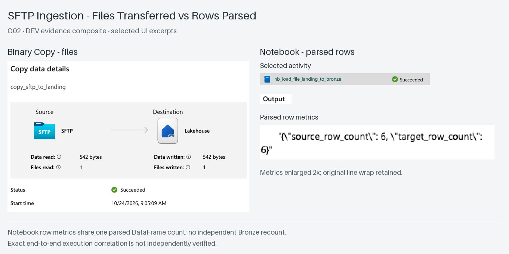

# File Ingestion Design

This is the design reference for the implemented SFTP-to-Landing-to-Bronze path. For an executable walkthrough,
start with the [SFTP ingestion guide](../guides/sftp-file-ingestion.md); for exact metadata values, use the
[DEV SQL seed](../../scripts/control/04_seed_ingestion_metadata.sql).

## Implemented scope

SFTP `FULL` and `INCREMENTAL` ingestion share FILE routing and the framework-wide watermark state. The scope includes:

- one shared `control.ingestion_config`
- first-class `source_path`, `landing_path`, and `file_format`
- pattern-specific parser/source-reading options stored in `source_options`
- no `control.file_ingestion_config`
- no Data Contract subsystem in the current scope
- no Quarantine / Reject Area

## Metadata model

`control.ingestion_config` is the single ingestion configuration table. For FILE, `source_object` is a **stable
logical feed name** (for example, `inventory_movement`), not a physical filename. The `source_path` and
`source_options.file_name_pattern` determine which files are eligible for that configuration; a run can match
multiple files. Checkpoints and terminal run audits belong to the configuration/run, not to separate per-file
receipt records.

The FILE-specific fields are `source_path`, `file_format`, `source_options`, and `landing_path`. The full column contract and sample
rows belong to the [Control Plane guide](../guides/control-plane.md) and
[SQL metadata seed](../../scripts/control/04_seed_ingestion_metadata.sql).

`source_path` locates source-owned deliveries. `landing_path` is the platform-owned Landing base path,
relative to the Lakehouse `Files` root.

For the DATABASE path, both fields are `NULL` because the source is already
identified by `source_schema` + `source_object` and the pipeline writes directly
to Bronze.

For FILE ingestion, both fields are first-class metadata. The FILE `landing_path` contract is strict: use
`landing/...` (relative to the Lakehouse **Files** root), never `Files/landing/...`. The adapter concatenates this
base path with `ingestion_date` and per-object execution segments without `replace()` or automatic path-prefix
correction. Fabric Copy receives the Files-relative `folderPath`; Bronze and Landing-cleanup notebooks prepend the
physical `/Files/` segment once. This path contract does not relocate historical audit paths or existing Landing files.

`file_format` is first-class FILE routing metadata because it changes how a raw Landing file is parsed into Bronze. The canonical values are `DELIMITED_TEXT`, `PARQUET`, and `JSON`.

`source_options` keeps parser/source-specific options that configure the selected parser but do not choose it. The
current delimited-text feeds require `file_name_pattern`, `delimiter`, `has_header`, `encoding`, `quote`, and
`escape`.

DATABASE configs use `file_format = NULL` and `source_options = NULL`. `copy_options` is a separate
optional execution-tuning envelope; seeded FILE configs leave it `NULL`, while the SQL Server adapter can use it for
connector-native partitioned Copy behavior.

## FILE flow

```text
Source connection + source_path
  -> Binary copy
  -> Landing + landing_path
  -> nb_load_file_landing_to_bronze
       -> format-specific reader
       -> common technical metadata
       -> Bronze Delta table
```

The source-to-Landing step is intentionally Binary so the delivered file is preserved byte-for-byte. Parsing starts only after the raw artifact reaches Landing.

The FILE Router evaluates `if_supported_file_format` before `sw_file_route`, using the
`p_file_format` contract (`@equals(toUpper(pipeline().parameters.p_file_format), 'DELIMITED_TEXT')`). Unsupported
formats are audited and failed once with `UNSUPPORTED_FILE_FORMAT` before invoking SFTP `FULL` or `INCREMENTAL`.
This gate precedes incremental LOW/HIGH resolution, so its failure audit has `NULL` processing bounds.
An invalid format therefore takes precedence over state or boundary validation.

`nb_load_file_landing_to_bronze` owns reader dispatch and also validates the format.
Only `DELIMITED_TEXT` is implemented; `PARQUET` and `JSON` are unsupported.
The Router rejects unsupported formats before raw Landing work starts.

Landing is retained for FILE ingestion because the delivered file is itself the raw ingestion artifact and can be reused for troubleshooting or reprocessing.

DATABASE ingestion remains direct-to-Bronze.

## Transfer consistency

The FILE pattern applies consistency controls per hop rather than forcing one
mechanism across every connector.

For SFTP-to-Landing Binary Copy, the adapter uses a framework-level
file-count gate after Copy succeeds:

```text
copy_sftp_to_landing
  -> filesRead == filesWritten
       -> true: continue
       -> false: finalize FAILED (LANDING_FILE_COUNT_MISMATCH) -> Fail
```

For `INCREMENTAL` SFTP, this gate runs before the no-new-data decision. Therefore
`0 filesRead / 0 filesWritten` is a valid consistent transfer and continues to
the no-new-data `SKIPPED` path with zero counts and no watermark advance, while a mismatched file count fails the run.

Landing-to-Bronze does not perform a second independent Bronze recount. The
notebook counts the parsed Landing DataFrame once, reuses that count as the
source/target audit metric after a successful atomic Delta append, and relies on
write failure plus the existing compensating-cleanup path for failed Bronze
writes. The audit count therefore documents rows processed by the successful
write; it is not an independent target reconciliation.

[](../assets/screenshots/composites/o02-file-vs-row-count.png)

*O02: DEV comparison of Binary Copy file counts (1 read, 1 written) and Notebook row counts (6 source, 6 target).*

The figure uses separate UI crops. The Notebook metrics excerpt is enlarged 2x with original line wrapping and no reconstructed text. Exact end-to-end execution linkage is unverified.

Transfer verification is connector-specific. Native Data Consistency Verification requires support for the actual
Copy pair and execution mode; otherwise a suitable fallback such as the SFTP file-count gate is needed.

## Failure behavior

The project does not implement Quarantine.

Fatal file-access or reader errors fail the ingestion run through the normal audit path.
The checked-in CSV reader does not set a parsing `mode`, so Spark's default
[`PERMISSIVE` mode](https://spark.apache.org/docs/latest/sql-data-sources-csv.html#data-source-option)
applies. Some malformed row-level CSV content may therefore be accepted without failing the run;
this does not guarantee acceptance of every malformed input. A file already copied to Landing
remains there for inspection/reprocessing.

When SFTP landing Copy fails or its file counts mismatch, Landing cleanup
recursively deletes only the validated leaf folder ending in
`ingestion_config_id=<config_id>/batch_id=<batch_id>/pipeline_run_id=<object_controller_run_id>/`.
The cleanup Notebook requires these three matching IDs and the ingestion date
before deletion; it cannot delete another config's shared-batch Landing files.

When a failed path may already have appended rows to Bronze, the framework invokes
the reusable `nb_cleanup_bronze_batch_rows` notebook. Cleanup is scoped to both the
current `_batch_id` and object `_pipeline_run_id`. If cleanup succeeds and verifies
that zero rows for that execution remain, the original ingestion failure is
finalized with watermark advancement disabled. If cleanup fails, the framework
can still finalize the run as `FAILED` with `BRONZE_CLEANUP_FAILED`; residual Bronze
rows may remain. Investigate and reconcile the affected batch before rerunning.
Unsuccessful cleanup does not guarantee rerun safety or provide business-key
deduplication.

The framework intentionally does not auto-clean after an ambiguous
`sp_finalize_success` failure because the control transaction may already have
committed.

Business data-quality and a governed Data Contract model are outside
the current implementation scope.

## FULL snapshot semantics

The `inventory_snapshot.csv` fixture represents the complete current
inventory. Its stable filename avoids a `FULL` config sweeping up historical
date-stamped snapshots in the same delivery folder. Each successful `FULL`
ingestion stores an execution-scoped Landing copy and appends a Bronze batch.
The separate `inventory_movement` FILE/`INCREMENTAL` feed uses the shared
checkpoint table and the remote SFTP Last Modified timestamp.

## SFTP source and Landing path

The demo models an external logistics vendor. The provider's
Warehouse Management System (WMS) publishes a complete inventory snapshot to its
SFTP outbound area. Fabric consumes that file into the platform-owned OneLake
Landing Zone before writing Bronze.

```text
External logistics vendor
  -> SFTP /outbound/inventory/
  -> Fabric Data Factory
  -> Files/landing/logistics_vendor/inventory_snapshot/
  -> Bronze fulfillment.inventory_snapshots
```

| Metadata field | Owner | Example path |
| --- | --- | --- |
| `source_path` | Source/provider delivery area | `/outbound/inventory/` |
| `landing_path` | Platform Landing area, relative to Lakehouse `Files` | `landing/logistics_vendor/inventory_snapshot/` |

Each object execution has its own Landing leaf:

```text
Files/landing/logistics_vendor/inventory_snapshot/
  ingestion_date=YYYY-MM-DD/
    ingestion_config_id=<config_id>/
      batch_id=<batch_id>/
        pipeline_run_id=<object_controller_run_id>/
```

The date organizes files. `ingestion_config_id` separates configurations, and the Object Controller's
`pipeline_run_id` separates executions even when the orchestrator shares a `batch_id`.
These segments prevent file collisions and keep Landing cleanup scoped to one execution.
Audit `landing_path` records the physical `Files/landing/...` folder; Copy and Notebooks receive
the relative `landing/...` path, with Notebooks prepending `/Files/` once.

The source inventory rows use the same SKU convention as the ECOMMERCE catalog
(`SKU000001`, `SKU000002`, and so on), which gives the demo a realistic
cross-source relationship without duplicating the SQL Server source tables.

## SFTP FULL sample and configuration

The active `LOGISTICS_VENDOR` `FULL` example reads `inventory_snapshot.csv` from `/outbound/inventory/` into
`fulfillment.inventory_snapshots`. It matches the exact source filename rather than sweeping historical movement
files and has **no watermark**. The raw columns and CSV contents are in the
[tracked fixture](../../scripts/source/sftp/outbound/inventory/inventory_snapshot.csv).

For the complete `source_options` JSON, logical connections, paths, and target settings, inspect the
[DEV metadata seed](../../scripts/control/04_seed_ingestion_metadata.sql). To follow the execution through Landing,
Bronze and audit, use the [SFTP walkthrough](../guides/sftp-file-ingestion.md). Keeping the sample values in their
source files avoids a second configuration specification here.

## SFTP account boundary (DEV)

The Docker Compose demo provisions one `atmoz/sftp` login, `sftp_logistics_vendor`.
Uploads use host-side SCP staging followed by copy into the bound outbound folder;
Fabric accesses that folder with the same identity. Separate producer and read-only
consumer accounts are not implemented.

## FILE incremental feed

The incremental FILE feed is:

```text
source_object      = inventory_movement
source_path        = /outbound/inventory/movements/
file_format        = DELIMITED_TEXT
file_name_pattern  = inventory_movement_*.csv
landing_path       = landing/logistics_vendor/inventory_movement/
target_table       = fulfillment.inventory_movements
load_strategy      = INCREMENTAL
watermark_field    = last_modified_time
```

FILE incremental reuses `control.pipeline_watermarks`; there is no
FILE-specific state table.

The initial checkpoint is:

```text
1900-01-01T00:00:00Z
```

For each `REGULAR` run, the adapter uses:

```text
LOW  = current last_watermark_value
HIGH = ingestion run start time
```

SFTP Last Modified timestamps represent UTC by source contract. Both Copy
filter bounds use the documented UTC `yyyy-MM-ddTHH:mm:ss.fffZ` representation.
The `REGULAR` upper bound preserves `p_start_time` (with `Z`), and successful
finalization commits it as the next checkpoint. An existing
no-`Z` lower checkpoint is used unchanged for optimistic state comparison
and formatted as UTC with `Z` only for SFTP Copy. `BACKFILL` bounds must
represent UTC instants; convert any non-UTC offset to UTC before supplying
it rather than just appending `Z`.

The adapter selects source files whose remote Last Modified timestamp falls within this window:

```text
LOW <= LastModified < HIGH
```

SFTP incremental discovery supports arbitrary nested subfolders beneath
`source_path` without implementing folder traversal in pipeline control flow.

The SFTP Copy activity performs one recursive Binary copy from the configured
source root to the batch-specific Landing folder. It applies the configured
`file_name_pattern` together with the LOW/HIGH Last Modified window and uses
`PreserveHierarchy`, so the connector itself handles arbitrary folder depth.

After Landing succeeds, `nb_load_file_landing_to_bronze` recursively
reads only that batch's Landing folder, parses the delimited files, adds the
technical lineage columns, and appends the result to the Bronze Delta table.

This keeps responsibilities narrow:

```text
SFTP connector
  = recursive discovery + Last Modified filtering + raw Binary landing

Notebook
  = recursive Landing parsing + technical metadata + Bronze Delta append
```

Every matching file is copied to the batch-specific Landing folder and then
appended to Bronze. The file's relative source-folder hierarchy is preserved
under the batch root, for example:

```text
source:
  /outbound/inventory/movements/2026/10/inventory_movement_20261002T150000Z.csv

landing:
  Files/landing/logistics_vendor/inventory_movement/
    ingestion_date=YYYY-MM-DD/
      ingestion_config_id=<config_id>/
        batch_id=<batch_id>/
          pipeline_run_id=<object_controller_run_id>/
            2026/
              10/
                inventory_movement_20261002T150000Z.csv
```

For `REGULAR` execution, matching files and a successful Bronze load allow
finalization to advance the watermark to `HIGH`. If no files match, the run is finalized as `SKIPPED` with zero rows and
**does not advance** the checkpoint; the next `REGULAR` scan retains the original
LOW. This intentionally allows a subsequent scan to discover late-arriving files
whose Last Modified falls within the previously empty window, at the cost of
rescanning that window. It does not guarantee detection of files delivered after
a later nonempty successful run has already advanced the watermark.

`run_type` and `load_strategy` are independent. The FILE config keeps its
configured `FULL` or `INCREMENTAL` strategy for every execution.

For an `INCREMENTAL` FILE config, `BACKFILL` reuses the bounded SFTP adapter and
applies the explicitly requested LOW/HIGH window to source-file Last Modified
time instead of the committed operational checkpoint. A successful `INCREMENTAL` `BACKFILL` does not advance the operational watermark.

For a `FULL` FILE config, `BACKFILL` rereads the same current source scope as `REGULAR`.
The distinction is execution intent and lineage; each successful run appends a new batch-specific Landing/Bronze copy.

| Timestamp / date | Origin and meaning |
| --- | --- |
| `p_start_time`, Landing `ingestion_date` | The Object Controller captures one UTC run-start instant as `yyyy-MM-ddTHH:mm:ss.fffZ`. The full string supplies FILE `REGULAR` HIGH; its UTC date forms the Landing path. |
| Bronze `_ingestion_timestamp` | After counting parsed Landing rows, the Notebook captures a separate UTC instant immediately before Delta append. It serializes milliseconds with `Z` before casting to Spark timestamp. This is approximate write-start time, not Delta commit time. |
| Bronze `_ingestion_date` | The UTC calendar date of that same Notebook instant. The write-scoped `mergeSchema` option adds this column to existing FILE Bronze tables. |

Landing `ingestion_date` and Bronze `_ingestion_date` can differ across UTC
midnight. SQL `DATETIME2(3)` represents UTC by convention.
FILE watermark HIGH is persisted as the exact UTC-with-`Z` object-run start string;
source-derived watermark bounds preserve their original precision and timezone
semantics. Do not append `Z` to a source-native value without a UTC contract.

The FILE Router validates `DELIMITED_TEXT` before the SFTP incremental adapter validates watermark state and
LOW/HIGH boundaries. The adapter then performs recursive Binary Copy into execution-scoped Landing and checks
`filesRead == filesWritten` before deciding whether to load Bronze. A consistent `0 / 0` finalizes as `SKIPPED`
without a Bronze write or checkpoint advance. With matching nonzero file counts, the Notebook parses Landing,
appends Bronze, and proceeds to success finalization.

For activity-level details, follow [Step A: state and boundary validation](../guides/sftp-file-ingestion.md#step-a-validate-state-and-establish-the-processing-window)
and [Step B: Copy, file counts, SKIPPED and Bronze loading](../guides/sftp-file-ingestion.md#step-b-discover-files-copy-to-landing-then-decide-whether-to-write-bronze).

The source filename remains evidence and lineage metadata in Bronze
(`_source_file_name`, `_source_file_path`) but is not used as the checkpoint.

Fixture names therefore do not need sortable sequence suffixes. The three checked-in movement fixtures use timestamped names, organized
by UTC year and month to exercise recursive source traversal:

```text
2026/09/inventory_movement_20260927T081500Z.csv
2026/09/inventory_movement_20260927T131500Z.csv
2026/10/inventory_movement_20261002T150000Z.csv
```

The adapter recursively discovers these subfolders and preserves the relative
hierarchy under each isolated Landing batch.

This strategy assumes the SFTP server exposes a reliable UTC Last Modified value
that reflects delivery/update time. A source that preserves stale timestamps
during late delivery or requires strict per-file receipt tracking would need a
different policy such as a manifest/receipt state model.

## Format-routing boundary

`source_connection_type` and `file_format` answer different questions:

```text
source_connection_type
= how the raw file reaches Landing

file_format
= how the Landing artifact is parsed into Bronze
```

For the current SFTP adapter:

```text
SFTP
  -> Binary copy to Landing
  -> nb_load_file_landing_to_bronze(p_file_format, p_source_options)
       -> DELIMITED_TEXT reader
       -> common Bronze write
```

The Notebook owns reader dispatch and the common lineage, row-count and Bronze-write steps.
Adding a format requires a new reader and compatible Router/adapter validation;
one connector's format support must not be assumed for every adapter.

For reproducible/new movement-file fixtures and upload testing, see the
[SFTP fixture instructions](../../scripts/source/sftp/README.md). The generator does not upload files or modify
Fabric state.
