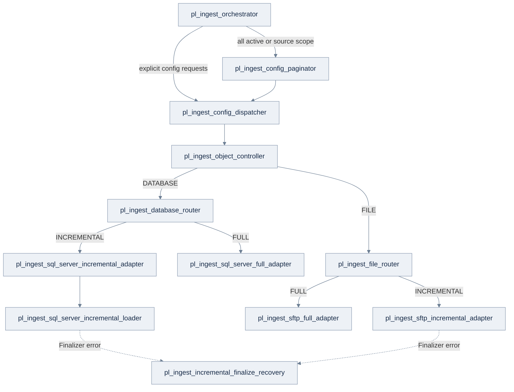
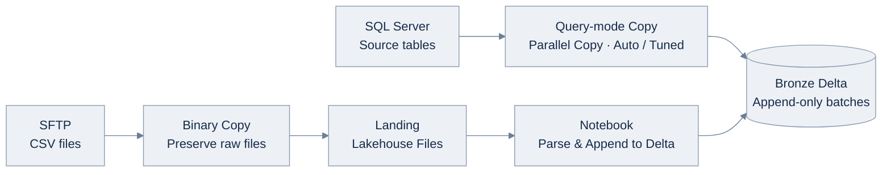

# Architecture & Design Decisions

The framework separates source configuration, orchestration, and physical ingestion so that adding source objects
does not require duplicating pipelines. This reference explains those boundaries, their trade-offs, and the
limits of the implemented SQL Server and SFTP paths.

## What problem does this solve?

As the number of source objects grows, separate table and file pipelines tend to repeat the same ingestion logic.
These separate pipelines may handle incremental checkpoints, retries, missing source data, audit logging, source
configuration, and destination naming differently.

The framework manages these shared decisions through a **metadata-backed Control Plane**. Adapters handle only
the *physical ingestion steps that depend on the source*.

## Orchestration and routing

The supporting Notebooks are:

- `nb_load_file_landing_to_bronze`: parse landed delimited-text files
  and append Delta rows with ingestion metadata;
- `nb_cleanup_bronze_batch_rows`: targeted compensation for failed
  writes using the **(`_batch_id`, `_pipeline_run_id`)** pair;
- `nb_cleanup_landing_batch_files`: targeted removal of the failed
  execution's Landing leaf directory.

The graph is intentionally not fully flattened. The incremental SQL adapter
owns watermark/no-new-data decisions; the separate loader keeps the nested
`AUTO`/`TUNED` Copy execution branch compatible with Fabric Pipeline
structure. Dashed edges indicate recovery invoked after a **failed success-finalization
activity**, not necessarily a confirmed watermark conflict. Only the implemented
SQL Server and SFTP `INCREMENTAL` paths invoke this recovery pipeline; `FULL` loads
do not use it.

### Pipeline roles and connector boundary

The `pl_ingest_<scope>_<role>` names reflect distinct responsibilities in the implemented execution graph:

| Role | Responsibility |
| --- | --- |
| Orchestrator | Only supported external entry point; chooses all-active, source-scoped, or explicit run requests |
| Paginator | Resolves all-active metadata in bounded pages; an empty active scope fails rather than silently succeeding |
| Dispatcher | Fans out a bounded collection of normalized object requests |
| Object Controller | Looks up and validates the chosen configuration and Lakehouse target, then selects DATABASE or FILE |
| Router | Selects connector and load strategy without owning vendor-specific extraction |
| Adapter | Executes source-specific extraction, boundary handling, and physical loading |
| Loader / Recovery | Optional boundaries for nested Copy execution or uncertain incremental finalization |

The **framework** owns `REGULAR`/`BACKFILL` intent, watermark/no-new-data semantics, Bronze append, audit/finalization,
and optimistic checkpoint protection. A **connector adapter** owns its connection, source SQL/predicates and
identifier quoting, boundary capture, type compatibility, and native Copy settings. An adapter must not silently
redefine the framework's state or finalization semantics.

The implemented DATABASE connector is SQL Server (`FULL` and `INCREMENTAL`); the FILE connector is SFTP. Additional
connectors need source-specific adapters that preserve framework state and audit semantics. Extract shared
connector logic only when another implementation demonstrates the same contract. Validate transfer verification
and Copy options for each connector and execution mode.

Fabric Pipelines handle orchestration and connector-native movement; Notebooks handle reusable Spark/Delta
operations such as file parsing and scoped cleanup. The relational SQL Server path deliberately stays with native
Copy instead of adding Spark just for uniformity.

## Logical planes and responsibilities

The README architecture visual separates three **logical responsibility groups**. They are not three isolated Fabric
systems: orchestration pipelines read Control SQL metadata, invoke data movement, and finalize audit/checkpoint
state.

| Logical plane | Responsibility |
| --- | --- |
| **Control & Audit** | Fabric SQL Database configuration, connection mappings, durable watermarks, terminal object audit, and transactional finalization |
| **Orchestration** | Fabric Data Pipelines that select requests, paginate active configurations, dispatch, validate, and route to connector/load-strategy adapters |
| **Data** | SQL Server query-mode Copy or SFTP Binary Landing + Notebook processing, writing to Lakehouse Bronze Delta |

The main Control/Audit and data components are:

| Component | Responsibility |
| --- | --- |
| `control.connection_settings` | Logical connection references resolved to Fabric source/target Connections |
| `control.ingestion_config` | One configuration per source object; ingestion pattern, `FULL`/`INCREMENTAL`, source/target metadata, optional Copy settings |
| `control.pipeline_watermarks` | Durable checkpoint per incremental config, shared by DATABASE and FILE adapters |
| `audit.ingestion_log` | One **terminal** object outcome per child Pipeline Run ID, including counts, bounds and error context |
| `control.usp_validate_run_requests` | Validate explicit request structure and avoid ambiguous dispatch inputs |
| `control.usp_finalize_ingestion_run` | Transactional audit and guarded/optimistic watermark advancement |
| Lakehouse Bronze | Append-only batches with execution lineage; distinct from Control SQL state |
| Monitoring SQL Views / Power BI | Read-only interpretation of *persisted object audits*, not full master-pipeline status |

**Operational path:** select config -> resolve connection -> validate source
and intended run -> ingest to Bronze -> finalize terminal audit and, on
eligible success, advance watermark. Finalization is guarded; Bronze and
SQL Control Database are **not** one distributed transaction.

## Two ingestion data paths

**DATABASE:** the SQL Server 2022 connector uses query-mode Copy for
both `FULL` and `INCREMENTAL`. Optional `copy_options` selects
`NONE | DYNAMIC_RANGE`, and optionally a positive `parallel_copies`
override backed by tests. `_ingestion_timestamp` is typed via the source
query as `DATETIME2(3)` before Bronze append. The SQL Source is a separate
SQL Server; the Control Plane is a **Fabric SQL Database**.

**FILE:** SFTP is copied in Binary to a scoped Landing directory first.
A Notebook then reads delimited text, appends technical metadata and writes
Delta. The parser implements `DELIMITED_TEXT` only; `PARQUET`/`JSON`
are not active readers. FILE incremental uses the *remote last modified*
timestamp, not the CSV payload date.

## Execution semantics

| Execution | Implemented behavior | Operational watermark |
| --- | --- | --- |
| `REGULAR` + `FULL` | Read the configured current source scope and append a new Bronze batch | None for `FULL` |
| `REGULAR` + `INCREMENTAL` | Read the saved LOW-to-HIGH window using SQL Server source bounds or the SFTP run-start boundary | Advance only after guarded successful finalization |
| `BACKFILL` + `FULL` | Reread the current full scope, append new batch | None for `FULL` |
| `BACKFILL` + `INCREMENTAL` | Read explicitly supplied historical LOW/HIGH, append new batch | **Never advance** |

- **DATABASE no new data:** a `REGULAR` timestamp window with `HIGH = LOW` is
  `SKIPPED` without invoking the loader and without checkpoint movement.
- **FILE no new data:** a valid window that matches no remote files is
  `SKIPPED` without Bronze write or checkpoint movement.
- `BACKFILL` + `FULL` is not a point-in-time historical snapshot.
- **Successful batch appends are immutable** by ingestion logic. Replay of an
  overlapping scope appends a distinct batch; this framework does not claim
  end-to-end exactly-once business-record semantics.

## Fault tolerance: what is and is not atomic?

A Copy or Notebook can write Bronze rows before Control SQL finalization completes. The framework uses
execution-scoped compensation and optimistic checkpoint protection because Delta and SQL do not share a
distributed transaction. Cleanup identifies the affected object by **both** `_batch_id` and `_pipeline_run_id`;
multiple objects can share a Batch ID. FILE Landing cleanup targets that execution's leaf folder.

Physical Bronze may contain rows from failed, cancelled, or unconfirmed executions.
Downstream consumers must use confirmed `SUCCESS` object-execution audits to identify committed ingestion data,
matching Bronze `(_batch_id, _pipeline_run_id)` to audit `(batch_id, pipeline_run_id)`.
A Batch ID alone is insufficient because multiple object executions can share it.
This repository does **not** implement that downstream `SUCCESS` consumption gate; see
[Bronze Compensating Cleanup](../operations/bronze-compensating-cleanup.md#limits-and-production-follow-through).

### What happens when something goes wrong?

Recovery depends on whether the failure occurred during the Bronze write or after SQL finalization was attempted.
A failed activity alone does not prove that the SQL transaction failed.

| Observed condition | Framework response | Why it matters |
| --- | --- | --- |
| A Copy or Notebook write fails after touching Bronze | Attempt cleanup using the failed object's `_batch_id` and `_pipeline_run_id`; record the failure. A cleanup failure is reported separately. | A failed object must not remove rows from another object in the same batch. |
| An incremental finalizer records `FAILED / WATERMARK_CONFLICT` | Verify the committed audit outcome, then compensate that execution's Bronze rows (and the FILE Landing leaf where applicable). | A stale run cannot move the operational checkpoint or keep its failed Bronze write as a successful batch. |
| A finalizer activity fails but the matching audit already says `SUCCESS` | Preserve the committed data; surface the response failure instead of deleting the batch. | An activity error can occur after a successful SQL commit. |
| The finalizer outcome cannot be read or confirmed | Preserve the affected data for operator reconciliation rather than performing blind cleanup. | Deleting a possibly committed batch could make state and data disagree. |

The finalization-recovery branches above apply to the implemented **incremental**
SQL Server and SFTP paths; do not assume the same recovery contract for `FULL`
loads or every possible failure. See [Bronze Compensating Cleanup](../operations/bronze-compensating-cleanup.md)
for the actual activity branches, audit codes, and verification steps.

## Engineering trade-offs and non-goals

| Choice | Why | What it does *not* solve |
| --- | --- | --- |
| One config table + JSON source/copy options | Consistent metadata with connector-specific extensibility | Schema evolution and vendor-neutral parsing for every future connector |
| Thin DATABASE/FILE router + adapters | Keep business-level state policy separate from physical connector implementation | Additional connectors without source-specific implementation and validation |
| Fabric Copy for SQL, Notebook for files | Use native movement engine; Spark only when parsing/Delta operations add value | General Spark transformation or Silver/Gold framework |
| `AUTO`/`TUNED` split | `AUTO` must omit `parallelCopies`; a DEV test observed different parallelism with explicit zero | Guaranteed optimum performance on arbitrary sources |
| Append-only successful batches | Preserve ingestion execution lineage, support intentional historical backfill | Global deduplication or a full snapshot versioning system |
| Source-status Power BI report | Simple audit-backed operational visibility without another ingestion pipeline | Live `RUNNING` view, failure before object audit, verified alert inbox delivery |

## Scaling and extension considerations

The current framework has one supported orchestration entry point and bounded parallelism. These choices provide
basic run-level control, but workloads with more sources, overlapping deployments, or stricter operational
requirements may need additional coordination:

- **Scheduling and dependencies.** Separate schedules can invoke `pl_ingest_orchestrator` with different
  `p_source_system` values. The framework does not coordinate dependencies between source-system runs. A
  dependency-aware scheduler would need to define what counts as completion, including `SKIPPED` and failed object
  outcomes.
- **Per-source concurrency.** The dispatcher uses a fixed `batchCount` to bound parallel ForEach iterations
  **within one run**. This is not a database-connection limit: one object execution can use multiple connections,
  and overlapping runs do not share this limit. Sources with different capacities may need separate concurrency
  policies or a shared per-source execution budget.
- **Overlapping executions and locking.** The checked-in master pipeline sets `concurrency = 1`, limiting
  simultaneous runs of that master within its workspace. This is not a lock on each ingestion configuration: another
  deployment, a changed concurrency setting, or work outside the master could still target the same state and Bronze
  data. Guarded SQL watermark finalization detects certain conflicts after work has begun; it does not prevent
  duplicate extraction or overlapping writes. Where cross-run exclusivity is required, define a per-configuration
  lock or lease policy before increasing concurrency.

These are **possible extensions, not implemented features**. The current framework does not provide cross-system
dependency coordination, shared per-source concurrency enforcement, or execution locks. The design should be
revisited only when workload requirements justify the additional complexity.

For deployment bindings, follow [Environment Rebuild](../operations/environment-rebuild.md). The
[Copy observations](database-copy-performance.md) describe limited DEV tests, not production-scale validation.
