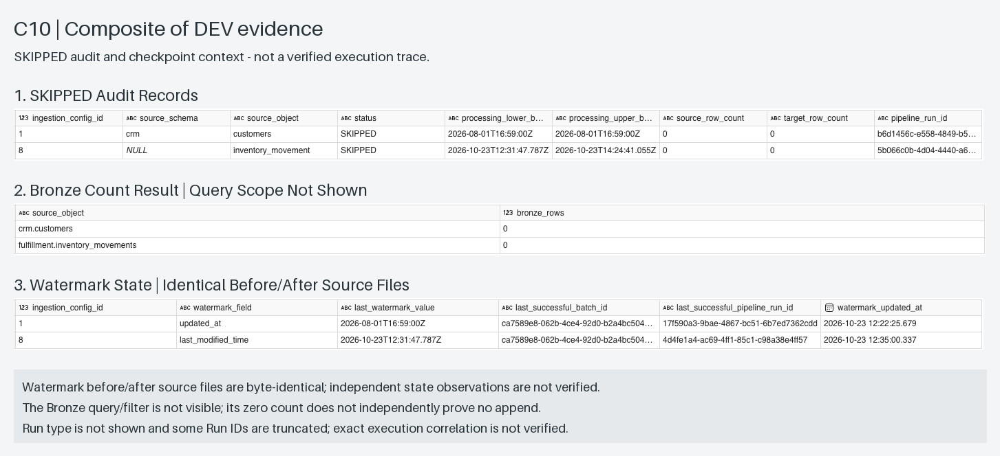

# Generic Incremental Watermark

This design describes the durable checkpoint shared by DATABASE and FILE incremental ingestion, including run
boundaries, no-new-data behavior, and guarded finalization. See the
[retry/rerun/backfill runbook](../operations/retry-rerun-backfill.md) for operational choices.

## Decision

The implemented DATABASE and FILE incremental paths share one persistent checkpoint table:

```text
control.pipeline_watermarks
```

The table stores the last committed checkpoint for one `ingestion_config_id`:

```text
watermark_field
last_watermark_value
last_successful_batch_id
last_successful_pipeline_run_id
watermark_updated_at
```

`last_watermark_value` is stored as a string (`NVARCHAR(1000)`), allowing each
adapter to interpret its checkpoint without a pattern-specific state table.

Examples:

| Pattern | `watermark_field` | Example checkpoint |
| --- | --- | --- |
| DATABASE | `updated_at` | `2026-09-27T10:30:00.000` |
| FILE | `last_modified_time` | `2026-09-27T10:30:00.000Z` |

## Watermark-state lookup contract

For the SQL Server and SFTP `INCREMENTAL` adapters, the initial
`lkp_current_watermark` filters **both** `ingestion_config_id` and
`watermark_field` in SQL. The `if_state_found` gate therefore checks whether
a checkpoint exists for that exact pair. A missing checkpoint **or a mismatched field**
follows `STATE_NOT_FOUND`, with the requested config ID and watermark field in the message.

The SFTP `INCREMENTAL` adapter checks `if_supported_watermark_field` **before**
`lkp_current_watermark` to reject unsupported field types with
`UNSUPPORTED_FILE_WATERMARK` even when no matching state row exists. For the
supported `last_modified_time` field, the lookup then checks for the exact
`ingestion_config_id` and `watermark_field` pair; no matching row produces
`STATE_NOT_FOUND`. The checkpoint's optimistic comparison during successful
finalization remains unchanged.

## Generic processing boundaries

The audit/finalization interface uses the same two generic boundary fields for
all ingestion patterns:

```text
processing_lower_bound
processing_upper_bound
```

Both are strings. `ingestion_pattern` and `watermark_field` provide the adapter context.

Examples:

```text
DATABASE
watermark_field          = updated_at
processing_lower_bound   = 2026-09-27T10:00:00.000
processing_upper_bound   = 2026-09-27T11:00:00.000

FILE
watermark_field          = last_modified_time
processing_lower_bound   = 2026-09-27T10:00:00.000Z
processing_upper_bound   = 2026-09-27T11:00:00.000Z
```

For DATABASE timestamp-watermark ingestion, boundary semantics are:

```text
REGULAR:
  upper > lower  -> process
  upper = lower  -> valid no-new-data window -> SKIPPED with zero rows; no watermark advance
  upper < lower  -> invalid boundary -> FAILED

BACKFILL:
  upper > lower  -> process
  upper <= lower -> invalid boundary -> FAILED
```

For FILE Last Modified ingestion, both `REGULAR` and `BACKFILL` require `upper > lower`. A scan with zero matching
files finishes `SKIPPED` with zero rows and **no operational watermark advance**, for either run type. For
DATABASE, a `REGULAR` `HIGH = LOW` scan also finalizes as `SKIPPED` without invoking the Loader or advancing state.
The triggers differ, but both patterns share the same no-new-data audit convention. A DATABASE `HIGH > LOW` run that
subsequently copies zero rows is a separate scenario and is not reclassified by this branch.

## Timestamp ownership and timezone contract

- Framework-created operational timestamp strings (`p_start_time`,
  `v_ingestion_timestamp`) represent UTC and carry a `Z` suffix. SQL audit
  `DATETIME2(3)` is stored as a timezone-less UTC value, by data type.
- Source-derived watermarks preserve their native type, precision and timezone
  interpretation. Do not blanket-convert watermarks to UTC or add `Z`.
  SQL Server `DATETIME2(7)` source boundaries remain source-local and can
  retain seven fractional digits; watermark state stores them exactly.
- At connector boundaries, adapt representation only where required. SFTP
  Last Modified filtering uses Microsoft's UTC `yyyy-MM-ddTHH:mm:ss.fffZ`
  form for both bounds. The legacy no-`Z` checkpoint is interpreted as UTC
  solely for this SFTP source contract and formatted with `Z` for Copy.
  A `REGULAR` upper bound comes from canonical `p_start_time` (with `Z`)
  and advances the checkpoint in that form only after successful `REGULAR` ingestion with matching files.
  The old committed lower-bound string is not rewritten prior to the optimistic
  watermark compare; no historical watermark rewrite is required.

## SQL Server DATETIME2 timestamp-watermark precision

For SQL Server incremental ingestion, the adapter preserves LOW/HIGH checkpoint values
from the control state and source Lookup without rounding or timestamp reformatting.
The shared `control.pipeline_watermarks.last_watermark_value` remains a string
(`NVARCHAR(1000)`) for exact optimistic-watermark comparison.

Both `AUTO` and `TUNED` Copy branches use `CONVERT(datetime2(7), '<boundary>', 126)`
in the **source SQL predicate**. SQL Server accepts timestamp strings with fewer
than seven fractional digits; `datetime2(7)` also preserves up to seven digits
from a higher-precision source. Do not use `formatDateTime(..., '...fff')`
on the boundary immediately before the SQL predicate: it would discard
fractional precision beyond milliseconds. This conversion is for source-side
filtering, not for storage of the checkpoint in the control SQL database.

Requested `BACKFILL` bounds must be SQL Server-parseable timestamps. ISO 8601
without an offset is appropriate for a timezone-naive SQL Server value, but
do not assume Fabric will preserve the **text representation** byte-for-byte
when transporting it. Source time-zone semantics must be specified separately.
The SFTP connector's Last Modified filter semantics and operational audit
timestamp precision are separate and unchanged.

### DEV runtime smoke test (2026-10-12)

The SQL Server 2022 on EC2 test exercised `REGULAR`/`AUTO` with isolated
`DATETIME2(7)` source `poc.watermark_precision_test`, config ID `11`
(`PRECISION_POC`) and Bronze target `crm.watermark_precision_test`.
It passed watermark-window selection and finalization after resolving a checkpoint representation mismatch:

- **Window selection:** ID 1 at `.1234567` (exclusive LOW), ID 2 at
  `.1234568`, ID 3 at `.1234569`, ID 4 at `.1240001` (inclusive HIGH).
  The source reader selected IDs **2, 3, 4**, with **3/3** read/copied rows.
- **Representation mismatch:** the initial checkpoint was
  `2026-10-08T10:00:00.1234567` without `Z`, but serialized LOW/HIGH carried `Z`.
  Copy wrote 3 rows; finalization recorded `FAILED / WATERMARK_CONFLICT` without
  advancing state because the stored string did not match LOW. Recovery left **0** rows for that execution.
- **Isolated rerun:** a guarded `UPDATE` added `Z` to this test checkpoint only
  (one row affected). A new top-level `REGULAR` run finished `SUCCESS`, with LOW
  `2026-10-08T10:00:00.1234567Z`, HIGH
  `2026-10-08T10:00:00.1240001Z`, audit **3/3**, and `last_watermark_value` committed to HIGH.
  All **seven** fractional digits survived in the bounds and checkpoint.
- **Bronze precision:** timestamps stored only **six** fractional digits:
  IDs 2 and 3 each appeared as `.123456`; ID 4 as `.124000`.
  All three rows survived, but this did **not** preserve full `DATETIME2(7)` timestamp fidelity.
  Downstream use of all seven digits would require a separate high-precision textual or numeric column.

**Acceptance boundary:** this validates only the observed SQL Server `REGULAR`/`AUTO` path
with matching checkpoint and serialized LOW strings. `TUNED`, `BACKFILL`, no-new-data paths
and other adapters were not validated by this test. It does not establish seven-digit Bronze
timestamps or arbitrary timezone normalization. A serialized `Z` does not prove that the source
SQL Server `DATETIME2` column represents UTC.

**Operational caution:** Optimistic concurrency deliberately compares the
checkpoint and LOW as strings. The isolated one-config adjustment above is not a checkpoint migration.
Preserve exact representation, not just datetime equality; do not bulk-rewrite production
checkpoints or disable the guarded compare to bypass `WATERMARK_CONFLICT`.

## FILE incremental choice

The first FILE incremental feed uses:

```text
watermark_field = last_modified_time
```

The SFTP adapter uses the connector's Last Modified window:

```text
modifiedDatetimeStart <= LastModified < modifiedDatetimeEnd
```

Both Copy bounds follow the UTC formatting and legacy-checkpoint rules in
[Timestamp ownership and timezone contract](#timestamp-ownership-and-timezone-contract).
`BACKFILL` LOW/HIGH must represent UTC instants (`Z` preferred); convert non-UTC offsets to UTC before
formatting them. These FILE rules do not change SQL Server `DATETIME2` source-watermark semantics.

Operationally, the lower boundary is the previously committed watermark and the
upper boundary is captured at the start of the current ingestion run. After a
successful `REGULAR` ingestion with matching files and a completed Bronze write, guarded finalization advances
the watermark to that upper boundary. When no files match, the status is `SKIPPED` and the checkpoint stays at LOW.

The source filename remains a file identity/evidence field, not the incremental
checkpoint.

The fixture names therefore only need to be unique and match the configured
pattern. They do not need a sortable `_001`, `_002` sequence.

## Delivery assumption

Last Modified is the default FILE checkpoint for this implementation because it
matches the native file filtering model of Microsoft Data Factory connectors.

The producer/source system must expose a reliable UTC Last Modified value that
changes when a file is newly delivered or replaced. If a future source preserves
old timestamps during late delivery, or requires strict per-file receipt
tracking, a manifest/receipt strategy is more appropriate than one scalar
watermark.

## Finalization

`control.usp_finalize_ingestion_run` compares the stored
`last_watermark_value` with `processing_lower_bound` before advancing it to
`processing_upper_bound`.

This optimistic comparison keeps the watermark state update and terminal audit
insert atomic inside the control SQL database.

A no-data FILE scan finishes as `SKIPPED` with zero rows and never advances its Last Modified
checkpoint. Audit processing LOW/HIGH still describe the attempted scan. A later
`REGULAR` run repeats that original LOW-to-new-HIGH range, allowing late-arriving
files to be discovered before any subsequent successful nonempty advance. This
is not a complete late-arrival guarantee once a later nonempty run advances state.

[](../assets/screenshots/composites/c10-no-new-data-skipped.png)

*C10: DEV composite showing `customers` and `inventory_movement` audits with `SKIPPED` and zero source/target rows, alongside a separate Bronze count result and one watermark-state panel.*

The Bronze query/filter is not visible, so its zero count does not independently prove no append. The watermark source files are byte-identical, not independent before/after observations. Run type is not visible, some Run IDs are truncated, and exact execution linkage is unverified.

## Run types and recovery

The framework run-type contract is intentionally small:

```text
REGULAR
= forward processing from the currently committed watermark

BACKFILL
= explicit historical LOW/HIGH processing that does not advance the operational watermark
```

Fabric Retry/Rerun is an execution-recovery mechanism, not a framework run type.
A failed `REGULAR` ingestion can be recovered by starting another top-level `REGULAR`
execution; the committed watermark remains the source of truth for the next
forward window.

`BACKFILL` may overlap a historical interval that was processed successfully before.
The framework does not delete or replace a previously successful Bronze batch when
that happens. Bronze remains append-oriented and each execution is distinguished by
its batch/run lineage.
