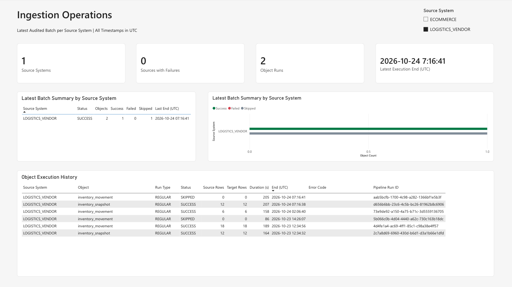

# Ingestion Operations: Monitoring Report

## Purpose and limits

The repository's Power BI Report `rpt_ingestion_operations` and Semantic
Model `sm_ingestion_operations` are authored in Power BI Desktop and tracked
in `fabric/` as PBIR/TMDL. The Report was synced to Fabric and verified
visually/operationally in DEV (2026-10-13).

The report reads **terminal object-level ingestion audit** from the Fabric SQL
Database. It does **not** create a separate master-run audit. It cannot show
`RUNNING` work, master failures before object audit, or unpersisted audit
outcomes; use Fabric Monitor for those cases. A "latest" audited batch may
be partially complete while other objects are still running.

## SQL views and metric grain

Execute `scripts/monitoring/01_create_monitoring_views.sql` against
`sqldb_ingestion_control`; the identical views are also tracked under
`fabric/sqldb_ingestion_control.SQLDatabase/audit/Views/`.

| SQL view | Grain / purpose |
| --- | --- |
| `audit.v_monitor_source_batch` | One row per **`source_system` + `batch_id`**, summarizing terminal object outcomes and timing |
| `audit.v_monitor_latest_source` | **One latest audited batch per `source_system`**, selected from the batch view |
| `audit.v_monitor_object_history` | One row per finalized object execution, including status, counts, error and Run ID |

These definitions do not alter Control/Watermark state or original audit rows.
Source Status is a **derived object outcome**; it is **not** a master
pipeline run state. Status precedence is
`FAILED > CANCELLED > WARN > SUCCESS > SKIPPED`.
The visual success/failed/skipped counts cover these three statuses only;
`WARN`/`CANCELLED` can still affect the summarized Source Status without having
separate chart series.

"Latest" means the source's batch with the latest **audited object `end_time`**.
Different source systems can display different Batch IDs; a previous
successful batch is not proof that the next scheduled run succeeded.

`Latest Execution End (UTC)` displays the internal `Latest Activity (UTC)` measure: the latest audited object
end time in the current filter context, not the report refresh time or a measurement of refresh latency.

## Semantic model

- DirectQuery to **operational Fabric SQL Database** (no scheduled Import
  refresh), with `LatestSource` and `ObjectHistory` tables.
- Active single-direction relationship:
  `LatestSource[source_system] (1) -> ObjectHistory[source_system] (*)`.
  Filtering selects *all historical objects from that source*, not just
  the source's latest batch.
- **7 DAX measures**, all on `LatestSource`:
  `Source Systems`, `Failed Sources`, `Objects`,
  `Latest Activity (UTC)`, `Successful Objects`,
  `Failed Objects`, `Skipped Objects`.
- `Failed Sources`, displayed as `Sources with Failures`, counts sources whose **latest audited batch status**
  is `FAILED`, not failed object executions. `Objects`, displayed as `Object Runs`, sums terminal object audit
  records from each source's latest audited batch, not configured objects or all historical records.
- The native `Latest Activity (UTC)` measure remains DateTime and is
  formatted without a text-conversion helper. Visual-level
  `source_system is not blank` filters exclude blank source systems.
- TMDL currently embeds the original DEV SQL Database server/database
  in its DirectQuery partitions: rebind in a **new** workspace by following
  [Environment Rebuild](environment-rebuild.md). Do not use those IDs
  blindly across environments.

## Report page: Operations

The page uses 16:9 layout. The visuals are:

| Section | Content |
| --- | --- |
| Header | `Ingestion Operations`; `Latest Audited Batch per Source System \| All Timestamps in UTC` |
| Slicer | `Source System`, nonblank values, no hardcoded source allowlist |
| KPI cards (4) | `Source Systems`, `Sources with Failures`, `Object Runs`, `Latest Execution End (UTC)` |
| Table | `Latest Batch Summary by Source System`: Source System, Status, Objects, Success, Failed, Skipped, Last End (UTC) |
| Clustered bar chart | `Latest Batch Summary by Source System`: Success, Failed, Skipped by Source System, using consistent status colors |
| History table | `Object Execution History`: Source System, Object, Run Type, Status, Source Rows, Target Rows, Duration (s), End (UTC), Error Code, Pipeline Run ID |

The following screenshots show the report in DEV.

*The latest audited batches show two source systems and eight object runs, with no sources reporting failures.*

Both latest source summaries are `SUCCESS`; history includes multiple batches with `SUCCESS`/`SKIPPED` outcomes and
`REGULAR`/`BACKFILL` run types. These are persisted object audits, not live master-pipeline states.

The summary Table and Chart sort `source_system` ascending;
Object History sorts `end_time` descending. All displayed timestamps
are UTC with seconds. Slicer and Chart exclude blank Source System directly.
No visual must depend on the names of the two demo sources.

*Selecting `LOGISTICS_VENDOR` shows one source system and two object runs in its latest audited batch.*

Six historical executions remain visible. Filtering by `source_system` selects its complete available audit
history, rather than restricting it to the latest Batch ID.

## Pipeline failure notifications (Activator DEV experiment)

Failure notifications are **separate from the Power BI audit report**. The optional Fabric Activator approach
watches Fabric pipeline job events for **`pl_ingest_orchestrator` = `Failed`**, then invokes an operator notification
action (such as email or Teams), rather than embedding a notification activity in each child. Source-scoped and
all-active runs use the same master pipeline item, but a `FAILED` run means a failure within **that run's scope**, not
every configured source system.

The currently tracked DEV Activator definition includes physical event-source bindings,
an email recipient, and rule settings with `shouldRun = true`. These are
environment-specific configuration, not proof of successful deployment or delivery.
For a new environment, review and rebind source references, configure the intended
recipient privately, and validate the rule configuration with notifications disabled.
Inspect the actual enabled/disabled state before explicitly enabling notifications.
A disabled, empty-recipient alternative remains **UNVERIFIED** for Fabric import
and is not implemented in this repository or approved for deployment.
To accept an alerting setup, verify the master `FAILED` event, a `FAILED` object audit
*when an object/config was resolved*, and **actual recipient receipt**. A master
failure before object resolution may create no object audit.

**Observed in DEV (2026-10-04):** two master `FAILED` events were detected, and Activator rule/action activity was
observed. **Delivery to the intended recipient inbox was not independently verified.** This proves event
detection/action invocation only, not an end-to-end verified notification service.

## Verification and observed results

- The DEV overview shows six `ECOMMERCE` object runs (1 `SUCCESS`, 0 `FAILED`, 5 `SKIPPED`) and two
  `LOGISTICS_VENDOR` object runs (1 `SUCCESS`, 0 `FAILED`, 1 `SKIPPED`).
- The latest execution end is `2026-10-28 01:48:42` UTC in the overview and `2026-10-24 07:16:41` UTC with
  `LOGISTICS_VENDOR` selected. These are observed results, not guarantees of future outcomes.
- Source-specific filtering, no blank slicer/chart category, timestamp
  display, historical sorting and the overall Report layout were reviewed.
- The repository owner confirmed that Fabric Git Sync completed and the canonical
  Desktop-authored Report worked normally in DEV.
- This evidence does **not** independently certify newest-batch failure
  behavior, every abnormal Pipeline path, fresh-data propagation latency,
  backup recovery, or alert recipient delivery.
- When re-creating DEV, check SQL views, DirectQuery credentials, the
  Slicer interaction and metric counts, not only that PBIR files import.
  See [Environment Rebuild](environment-rebuild.md).

### Source of truth

- `fabric/rpt_ingestion_operations.Report/`: PBIR visual/layout definition.
- `fabric/sm_ingestion_operations.SemanticModel/`: DAX, M partitions and
  relationships.
- `scripts/monitoring/01_create_monitoring_views.sql`: runnable SQL views.
- `fabric/sqldb_ingestion_control.SQLDatabase/audit/Views/`: SQL Project views.

Follow [Environment Rebuild](environment-rebuild.md#g-rebind-operational-power-bi) for deployment and source
rebinding. Author report/model changes in Power BI Desktop and commit the native PBIR/TMDL definitions under
`fabric/`.
